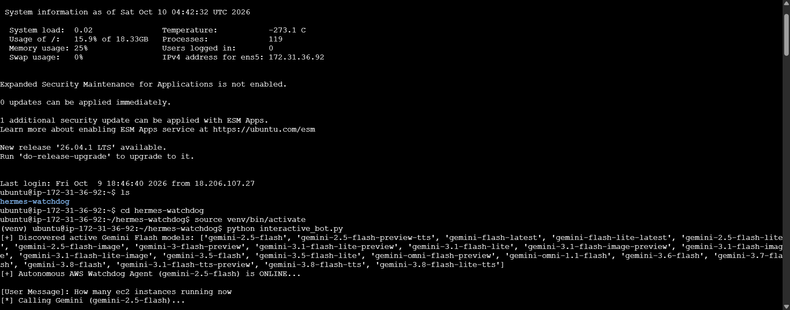
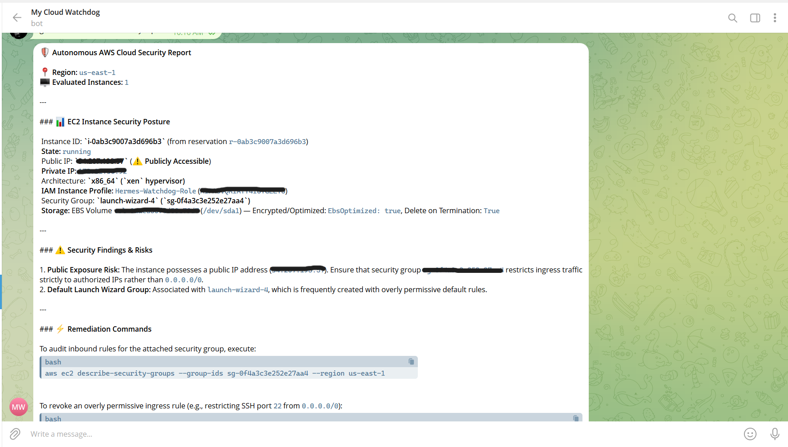
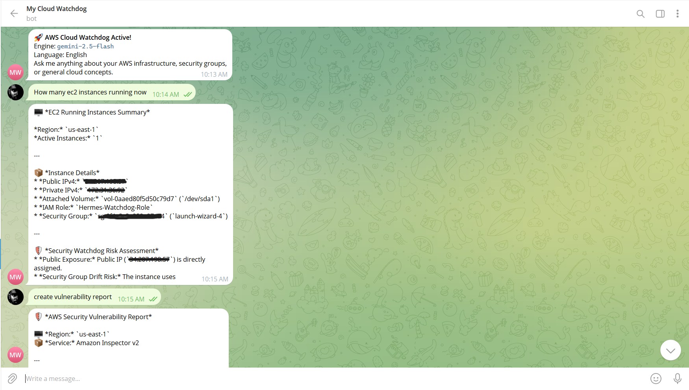

#  AWS Cloud Security & Operations Watchdog

An autonomous, conversational Cloud SecOps Telegram assistant hosted on AWS EC2. It performs real-time infrastructure audits, monitors
for security group drift (e.g., ports exposed to `0.0.0.0/0`), queries live AWS account telemetry via dynamic CLI execution and Boto3, and
delivers clean, mobile-optimized cards with single-tap CLI remediation commands.

---

##  System Architecture

```text
 ┌────────────────────────────────────────────────────────┐
 │                   Telegram Client                      │
 └───────────────────────────┬────────────────────────────┘
                             │ (User Question / Audit Request)
                             ▼
 ┌────────────────────────────────────────────────────────┐
 │             EC2 Host (Autonomous Watchdog)             │
 │                                                        │
 │  ┌──────────────────────────────────────────────────┐  │
 │  │ 1. Dynamic Model Discovery & Query Routing       │  │
 │  │    (Google Gemini 2.5 Flash REST API)            │  │
 │  │    - Classifies: Live Resource Query vs General  │  │
 │  │    - Plans safe read-only AWS CLI commands       │  │
 │  └──────────────────────────┬───────────────────────┘  │
 │                             ▼                          │
 │  ┌──────────────────────────────────────────────────┐  │
 │  │ 2. Read-Only Execution Engine & Telemetry        │  │
 │  │    - AWS CLI & Boto3 SDK (EC2, IAM, S3, VPC)     │  │
 │  │    - Enforces read-only safety checks            │  │
 │  └──────────────────────────┬───────────────────────┘  │
 │                             ▼                          │
 │  ┌──────────────────────────────────────────────────┐  │
 │  │ 3. Markdown Sanitizer & Card Formatter           │  │
 │  │    - Normalizes syntax for Telegram mobile       │  │
 │  │    - Generates one-tap copyable CLI bash fixes   │  │
 │  └──────────────────────────────────────────────────┘  │
 └───────────────────────────┬────────────────────────────┘
                             │
                             ▼ (Formatted Mobile Card Response)
 ┌────────────────────────────────────────────────────────┐
 │                    Telegram User                       │
 └────────────────────────────────────────────────────────┘

```

---

##  Features

* **Natural Language Cloud Queries:** Ask infrastructure questions in plain English (e.g., *"How many IAM roles do I have?"*, *"List all running EC2 instances"*, *"Show my VPCs"*).
* **Automated Security Drift Audits:** Identifies critical ingress exposures (`0.0.0.0/0`) on sensitive ports (SSH `22`, HTTP `80`, RDP `3389`) and discovers orphaned EBS volumes.
* **One-Tap Remediation Commands:** Automatically outputs single-line `aws ec2 revoke-security-group-ingress` commands inside clean code blocks for rapid copy-pasting on mobile.
* **Dynamic Model Discovery:** Automatically queries Google's `ModelService` to discover active text models, targets `gemini-2.5-flash`, and excludes audio/TTS models.
* **Strict Telegram Markdown Sanitization:** Pre-processes LLM responses to eliminate unsupported tags (`###` headers, raw backslashes, nested bullets), ensuring Telegram never fails to parse cards.
* **Resilient Fallback Engine:** Automatically returns raw telemetry if API rate limits or network issues occur, preventing the bot from hanging.

---

##  Repository Structure

```text
aws-cloud-watchdog-agent/
├── interactive_bot.py      # Core agent loop, model discovery, and query router
├── requirements.txt        # Pinned Python package dependencies
├── .env.example            # Environment variables template
├── iam-policy.json         # Least-privilege IAM policy definition
├── aws-watchdog.service    # Systemd daemon configuration file
├── .gitignore              # Ignores virtual environments and secrets
├── LICENSE                 # MIT License
└── README.md               # Project documentation

```

---

##  Prerequisites

1. **AWS EC2 Instance:** Ubuntu 22.04 / 24.04 LTS (e.g., `t3.micro` or `t2.micro`).
2. **IAM Role Attached to EC2:** An instance profile with read-only permissions (see [`iam-policy.json`](https://www.google.com/search?q=iam-policy.json)).
3. **Telegram Bot Token & Chat ID:** Obtained from [@BotFather](https://t.me/BotFather) and your target Telegram account ID.
4. **Google AI Studio API Key:** Free API key from [aistudio.google.com](https://aistudio.google.com/).

---

##  Live Telemetry & Audit Proof

### 1. EC2 Runtime Engine & Dynamic Model Resolution
The bot boots on EC2, dynamically scans Google's `ModelService` for active text-generation models (`gemini-2.5-flash`), and monitors user commands via the Telegram Bot API:



---

### 2. Live Telegram SecOps Auditing & Remediation
Real-time resource evaluation, risk identification for open ingress CIDRs (`0.0.0.0/0`), and copy-paste remediation commands delivered directly to mobile:

<p align="center">
  
  
</p>

##  Quickstart Guide

### 1. Clone & Set Up Python Environment

```bash
git clone [https://github.com/ChalanaDilshan/aws-cloud-watchdog-agent.git](https://github.com/ChalanaDilshan/aws-cloud-watchdog-agent.git)
cd aws-cloud-watchdog-agent

python3 -m venv venv
source venv/bin/activate
pip install -r requirements.txt

```

### 2. Configure Environment Variables

Create your `.env` file using the provided template:

```bash
cp .env.example .env
nano .env

```

Populate your secrets:

```env
TELEGRAM_BOT_TOKEN="your_bot_token_from_botfather"
TELEGRAM_CHAT_ID="your_numeric_telegram_chat_id"
GEMINI_API_KEY="AIzaSy_your_gemini_api_key"
AWS_DEFAULT_REGION="us-east-1"

```

Export them into your current shell:

```bash
export $(grep -v '^#' .env | xargs)

```

### 3. Run Manually

```bash
python interactive_bot.py

```

---

##  Running 24/7 as a Background Daemon (systemd)

To ensure the watchdog stays online permanently across terminal disconnects and EC2 restarts, register it as a Linux service:

```bash
# 1. Copy service file to systemd directory
sudo cp aws-watchdog.service /etc/systemd/system/

# 2. Reload systemd daemon
sudo systemctl daemon-reload

# 3. Enable and start the service
sudo systemctl enable --now aws-watchdog

# 4. Verify service status
sudo systemctl status aws-watchdog

```

To view live application logs:

```bash
journalctl -u aws-watchdog -f

```

---

##  Security & Least-Privilege IAM Policy

The bot is designed with security-first boundaries:

* **Strict Read-Only Verification:** The execution engine parses all CLI commands and rejects any action that does not begin with `describe`, `list`, `get`, `select`, or `head`.
* **Zero Credential Storage:** Uses EC2 Instance Metadata Service (IMDSv2) via IAM Roles instead of storing hardcoded AWS Access Keys.

Attach the following policy to your EC2 Instance Role:

```json
{
  "Version": "2012-10-17",
  "Statement": [
    {
      "Sid": "WatchdogReadOnlyTelemetry",
      "Effect": "Allow",
      "Action": [
        "ec2:DescribeInstances",
        "ec2:DescribeSecurityGroups",
        "ec2:DescribeVolumes",
        "ec2:DescribeVpcs",
        "ec2:DescribeSubnets",
        "iam:ListRoles",
        "iam:ListUsers",
        "s3:ListAllMyBuckets",
        "s3:GetBucketLocation"
      ],
      "Resource": "*"
    }
  ]
}

```

---


##  Sample In-Chat Interactions

| User Prompt | Watchdog Action | Sample Response Format |
| --- | --- | --- |
| `give me audit report` | Scans SGs for `0.0.0.0/0` and unattached EBS disks | 🚨 Security audit card listing exposed ports, risk levels, and copy-paste remediation commands |
| `how many IAM roles active` | Queries IAM via `boto3` / `list-roles` | 🔑 Card showing total active roles and itemized names |
| `how many ec2 instances running` | Queries EC2 reservations | 🖥️ Instance summary with IDs, types, and IP addresses |
| `what is port 5001 used for?` | General knowledge classification | 🛡️ Security explanation and best practices without triggering AWS CLI |

---

##  License

This project is licensed under the MIT License - see the [LICENSE](https://www.google.com/search?q=LICENSE) file for details.
